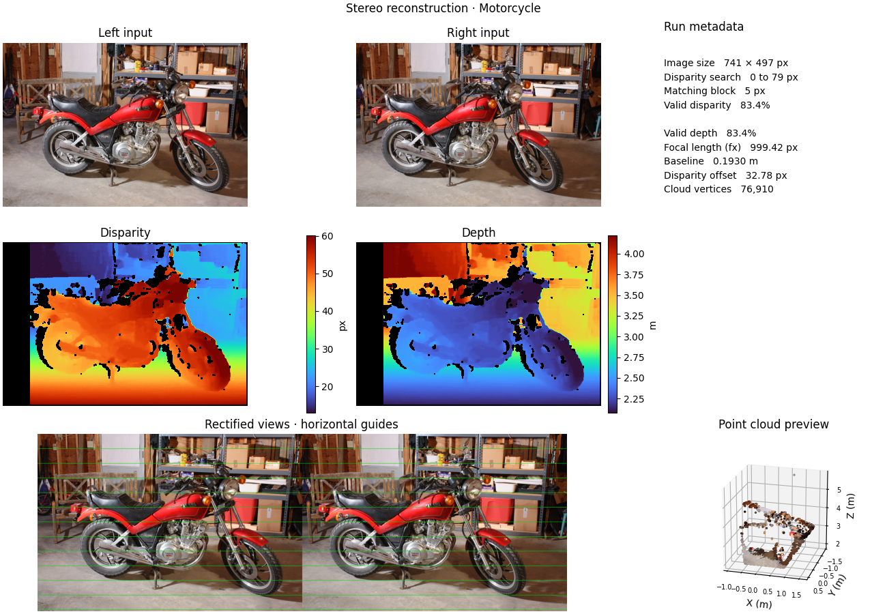
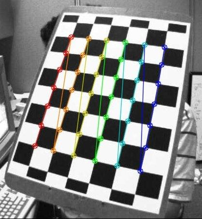
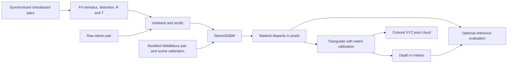
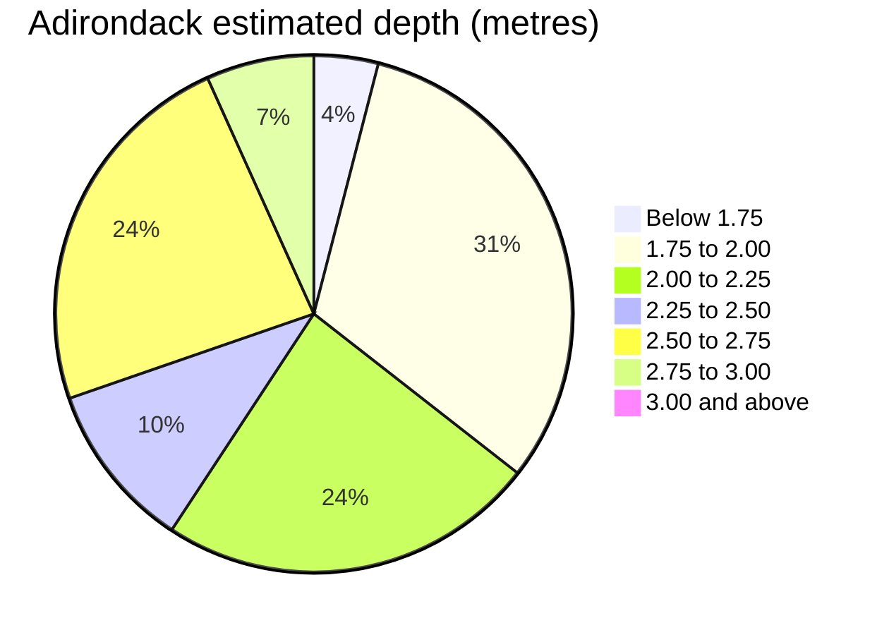

# stereo-depth-estimation-opencv

This repository implements a stereo depth estimation pipeline in Python using OpenCV and Open3D. 
It supports stereo camera calibration and image rectification, estimates disparity with OpenCV’s StereoSGBM, and converts the resulting depth map into a colored 3D point cloud.
The included Middlebury example uses pre-rectified images and the dataset’s published calibration



## Quick start

Open **Anaconda Prompt** on Windows or a terminal with Conda available on macOS or Linux. You can use an existing environment with Python 3.8–3.12. For example, from the repository folder:

```sh
conda activate yolov11
python -m pip install -r requirements.txt
```

Use the name of your environment in the `conda activate` command. If you need to create one, use `conda create -n stereo-depth python=3.8 pip`. Inside the active environment, pip installs the dependencies listed in `requirements.txt`. In PyCharm, select that same Conda interpreter.

```sh
python main.py
```

In PyCharm, open `main.py` and press **Run**. The default workflow processes the Middlebury `trainingQ` scenes alphabetically and saves a timestamped folder for each successful reconstruction under `outputs/`. The terminal logs the current scene and processing stage. If a reconstruction fails, the run continues through the split and exits with an error listing the failed scenes. With `visualize = True`, close each summary window to move to the next scene. Summary failures are logged as warnings. If the split folder is missing, run `python download_datasets.py --only middlebury` first.

Edit [config.py](config.py) to change the workflow, input paths, or reconstruction settings. Run the same `main.py` file after saving your changes.

# Theory and Intuition: How Stereo Depth Estimation Works

## 1. The big picture: Why two cameras?

Imagine your eyes. Each eye sees the same object from a slightly different angle. Your brain uses that difference to perceive depth.

Stereo cameras work the same way.

```text
             OBJECT
               *
              / \
             /   \
            /     \
           /       \
          /         \
     LEFT CAM     RIGHT CAM
          <----------->
             Baseline
```

The **baseline (B)** is the physical distance between the cameras.

Our goal is to calculate how far away the object is.

## 2. What is camera calibration?

Before measuring depth, we need to understand our cameras.

**Camera calibration = figuring out the camera's geometry.**

There are two types of parameters.

### A. Intrinsic parameters: What's inside each camera?

These describe how the camera projects 3D points onto its 2D image.

The intrinsic matrix is:

$$
K=\begin{bmatrix}
f_x&0&c_x\\
0&f_y&c_y\\
0&0&1
\end{bmatrix}
$$

- $f_x,f_y$: Focal lengths in pixels.
- $c_x,c_y$: Principal point (approximately the image centre).
- **Distortion coefficients:** Describe how the lens bends the image.

### B. Extrinsic parameters: Where are the cameras relative to each other?

These describe their relative positions and orientations.

- $R$: Rotation matrix.
- $T$: Translation vector.

```text
LEFT CAMERA                 RIGHT CAMERA
    |                            /
    |                           /
    |                          /
    v                         v

          R = Rotation
          T = Translation
```

For stereo, we need to know both cameras' intrinsics and their relative rotation and translation.

## 3. Why do we photograph a chessboard?



Because the chessboard has a known, regular geometric pattern.

OpenCV detects the internal corners:

```text
+---+---+---+---+
|   |   |   |   |
+---o---o---o---+
|   |   |   |   |
+---o---o---o---+
|   |   |   |   |
+---+---+---+---+
```

We photograph it at different angles and positions.

OpenCV compares the detected 2D corners against their known 3D arrangement and estimates the camera parameters.

| OpenCV function | What it does |
|---|---|
| `findChessboardCorners()` | Detects chessboard corners |
| `calibrateCamera()` | Estimates each camera's intrinsics and distortion |
| `stereoCalibrate()` | Estimates relative rotation and translation between cameras |

**Important:** To recover real-world measurements in metres, we must know the physical chessboard square size.

## 4. What happens after calibration?

We perform **stereo rectification**.

Imagine the cameras aren't perfectly aligned:

```text
BEFORE RECTIFICATION

Left camera         Right camera
     |                    /
     v                   /

Corresponding points may
appear on different image rows.


AFTER RECTIFICATION

Left image           Right image
     |                    |
     v                    v

Corresponding points lie
on the same horizontal row.
```

OpenCV uses `stereoRectify()` and `remap()` to transform the images into this aligned geometry.

Why? Because now matching points only requires searching horizontally, rather than across the entire image.

## 5. Disparity: Finding the same point twice

Suppose the same object point appears at:

```text
LEFT IMAGE
0 ----------- X ---------------- 640
              350 px

RIGHT IMAGE
0 --------- X ------------------ 640
            310 px
```

Disparity:

$$
d=x_L-x_R=350-310=40\text{ pixels}
$$

OpenCV's `StereoSGBM` estimates this disparity for many pixels across the images, producing a **disparity map**.

**SGBM** stands for **Semi-Global Block Matching**. For each pixel in the left image, it compares a small patch around that pixel, typically 5 × 5 pixels here, with candidate patches along the same row in the rectified right image. If the left patch is centred at x = 350 and its match is at x = 310, the disparity is 40 pixels. Patches overlap, so the resulting disparity map can have a value at every pixel. The semi-global step combines evidence along several directions to favour consistent disparities in neighbouring areas while allowing jumps at object boundaries.

## 6. Finally: Convert disparity into depth

For the standard rectified stereo setup:

$$
\boxed{Z=\frac{fB}{d}}
$$

For example:

- Focal length = 700 pixels
- Baseline = 0.12 metres
- Disparity = 40 pixels

$$
Z=\frac{700\times0.12}{40}=\boxed{2.1\text{ metres}}
$$

We can also use `reprojectImageTo3D()` to obtain 3D coordinates $(X,Y,Z)$, creating a point cloud.

## 7. The entire pipeline

```text
          CHESSBOARD IMAGES
                  |
                  v
          CAMERA CALIBRATION
                  |
                  v
       Intrinsics (K, distortion)
       Extrinsics (R, T)
                  |
                  v
LEFT IMAGE ---> RECTIFICATION <--- RIGHT IMAGE
                  |
                  v
          ALIGNED IMAGES
                  |
                  v
             StereoSGBM
                  |
                  v
           DISPARITY MAP
                  |
                  v
        DEPTH / 3D REPROJECTION
                  |
             +----+----+
             |         |
             v         v
         DEPTH MAP  POINT CLOUD
```

**One final distinction about the datasets:**

- **OpenCV chessboard images:** Used to learn and demonstrate camera calibration.
- **Middlebury images:** Already rectified and supplied with calibration information, so you can start directly at disparity estimation.

That's the complete story: **calibrate the cameras → align the images → match corresponding pixels → calculate depth → reconstruct 3D.**

## How this project implements the theory

The pipeline uses `findChessboardCornersSB()` to detect chessboard corners. For Middlebury, the supplied calibration can have different horizontal principal points, so the depth formula includes the offset shown below.



For a point at axial depth $Z$, let the rectified, right camera center sit a distance $B$ to the right of the left camera center. In a rectified pair with common focal length $f_x$, the horizontal projections are

$$
x_L = f_x\frac{X}{Z} + c_{x,L}, \qquad
x_R = f_x\frac{X-B}{Z} + c_{x,R}.
$$

Subtract the projections to get disparity $d=x_L-x_R$. Solving for $Z$ gives

$$
Z = \frac{f_x B}{d + (c_{x,R}-c_{x,L})}, \qquad
X = \frac{(x_L-c_{x,L})Z}{f_x}, \qquad
Y = \frac{(y_L-c_{y,L})Z}{f_y}.
$$

Focal lengths, principal points and disparity are in pixels. This project converts Middlebury's baseline from millimetres to metres, so the depth and XYZ outputs are in metres. The principal-point difference is Middlebury's `doffs`. OpenCV's zero-disparity rectification gives coincident principal points for the raw-camera workflow. [Middlebury calibration format](https://vision.middlebury.edu/stereo/data/scenes2014/)

When the horizontal principal points coincide, the formula simplifies to $Z=f_x B/d$. With $f_x=700$ px, $B=0.12$ m, and a 40 px shift, for example, the depth is $700 \times 0.12 / 40 = 2.1$ m. These illustrative values show how pixel disparity translates into physical depth.

StereoSGBM stores disparity with four fractional bits. The pipeline divides by 16 and masks the invalid sentinel and pixels outside the matching ROI. Signed or zero disparities can represent valid matches when the principal points differ. Triangulation requires positive $d+\mathrm{doffs}$. The cloud uses OpenCV's homogeneous reprojection and Open3D PLY export. Its axes are $+X$ right, $+Y$ down and $+Z$ forward in the rectified left camera frame. [OpenCV StereoSGBM](https://docs.opencv.org/4.x/d2/d85/classcv_1_1StereoSGBM.html) · [Open3D point cloud export](https://www.open3d.org/docs/release/python_api/open3d.io.write_point_cloud.html)

## Datasets

`download_datasets.py` uses the existing `data/` layout and skips files and archives already downloaded and extracted.

```text
data/
├── calibration/
│   ├── left/left01.jpg, …
│   └── right/right01.jpg, …
└── middlebury/MiddEval3/
    ├── trainingQ/Adirondack/{im0.png, im1.png, calib.txt}
    └── testQ/Australia/{im0.png, im1.png, calib.txt}
```

- The **OpenCV chessboard samples** have 13 synchronized 640 × 480 pairs numbered 01–14, with 10 absent. The board has 9 × 6 inner corners. The sample files provide no verified physical square size. [OpenCV sample data](https://github.com/opencv/opencv/tree/4.11.0/samples/data) · [OpenCV stereo calibration example](https://github.com/opencv/opencv/blob/4.11.0/samples/cpp/stereo_calib.cpp)
- **Middlebury Stereo Evaluation v3**, by Daniel Scharstein and Heiko Hirschmüller, provides 15 training and 15 test scenes in the quarter-resolution input archive. The training reference archive adds `disp0GT.pfm` and `mask0nocc.png` alongside each training pair. Test ground truth is withheld. Some pairs have residual vertical disparity even though they are already rectified. Use the calibration file shipped with the exact resolution of each pair. [Eval3 downloads and SDK](https://vision.middlebury.edu/stereo/submit3/) · [2014 dataset credits and paper](https://vision.middlebury.edu/stereo/data/scenes2014/)

```sh
python download_datasets.py --only middlebury
python download_datasets.py --only chessboard
python download_datasets.py --only ground-truth
```

## Calibrate and rectify a stereo rig

1. Capture synchronized views of a flat checkerboard with a rigid stereo mount. Vary the target distance and tilt and move it around the frame. Keep the image resolution, focus and zoom fixed between calibration and reconstruction.
2. Put left and right files in separate directories. Use identical filename stems or numbered names such as `left01.jpg` and `right01.jpg`. Count the **inner corners** as columns and rows. Measure one printed square edge in millimetres for metric reconstruction.
3. In `config.py`, set `workflow = "calibrate"` and point `chessboard_left_dir` and `chessboard_right_dir` at your captures. Set `board_size` to the inner corner counts. For metric depth, set `square_size_mm` to the measured edge length. Run `main.py` to save the model at `calibration_path`. Choose an unused path when recalibrating.
4. Set `workflow = "pair"` and set `left_image` and `right_image` to the raw stereo images to reconstruct. Run `main.py` again. Inspect `epipolar.png` to see whether corresponding features line up on horizontal guides.

The default chessboard folders and images use the OpenCV sample. With `square_size_mm = None`, this workflow saves rectified images and disparity, and its calibration translation is in board-square units. The Middlebury workflow gets its metric baseline from each scene.

## Settings and outputs

| In `config.py` | What it controls |
| --- | --- |
| `workflow` | Choose `"middlebury"`, `"calibrate"`, or `"pair"`. |
| `scene_dir` | Middlebury split directory, such as `trainingQ`, containing the calibrated scene folders to process. |
| `visualize` | Open a summary and save it as a PNG. For Middlebury, close each window to advance through the selected split. |
| `evaluation` | Middlebury ground-truth evaluation mode. Choose `"off"`, `"all"`, or `"non_occluded"`. |
| `num_disparities` | Optional search span in pixels, in multiples of 16. With `None`, use the scene's rounded-up `ndisp` or `pair_num_disparities` for raw pairs. |
| `rectification_alpha` | Use 0 to crop to valid pixels or 1 to preserve the full field of view for raw pairs. |
| `block_size`, `uniqueness_ratio`, `speckle_window_size` | Tune matching and rejection of isolated matches. |
| `max_depth_m` | Limit exported depths and point clouds to this distance. Evaluation uses the full depth estimate. |
| `cloud`, `cloud_stride`, `bad_px`, `bad_depth_m` | Set point-cloud export and evaluation thresholds. |

| Artifact | Contents |
| --- | --- |
| `disparity_px.npy`, `depth_m.npy` | Float32 arrays at image resolution, with `NaN` for invalid values. Metric depth requires a calibrated baseline. |
| `disparity_px.png`, `depth_m.png` | Turbo previews with black invalid pixels. The display is clipped at the 2nd and 98th percentiles recorded in `run.json`. |
| `epipolar.png` | Horizontal guides across both rectified views for checking alignment. |
| `left_rectified.png`, `right_rectified.png` | Rectification results from `pair`. |
| `cloud_m.ply` | Metric XYZ and left-view RGB, sampled by `cloud_stride` along each axis. |
| `*_error_px.*`, `*_error_m.*` | Absolute error arrays and previews on the valid reference overlap. |
| `run.json` | Input paths, settings, calibrated geometry, preview ranges, cloud size and available metrics. |
| `summary.png` | With visualization enabled, shows both input images, epipolar alignment, disparity and depth, a sampled point cloud when available, and run metadata. |

With visualization enabled, chessboard calibration shows the detected corners and fit errors and saves a `*_summary.png` next to the calibration JSON. With a non-interactive Matplotlib backend such as Agg, the scene summaries are saved as PNGs and processing proceeds automatically.

## Evaluation and example results

Set `evaluation = "all"` in `config.py` to score every finite pixel in the quarter-resolution disparity reference `disp0GT.pfm`. Use `"non_occluded"` to score only pixels marked 255 in `mask0nocc.png`. The default `"off"` skips evaluation. If an enabled evaluation has a missing or invalid reference, the run logs a warning and still saves the reconstruction.

```sh
python download_datasets.py --only ground-truth
python main.py
```

MAE and RMSE are computed over pixels with both a finite reference and a valid estimate. Coverage is the estimated fraction of reference pixels. The bad-pixel percentage counts both errors strictly above the threshold and missing estimates. The default thresholds are 2 px for disparity and 0.10 m for depth. Reference depth is triangulated from reference disparity using the same calibration. These are local Q-resolution metrics. The official benchmark uses its own full-resolution scoring protocol. [Eval3 evaluation protocol](https://vision.middlebury.edu/stereo/submit3/)

The measured Adirondack run used OpenCV 4.11.0, an 80 px search span and cloud stride 2. It reconstructed 72,768 colored vertices. The non-occluded reference covered 325,114 pixels.

| Map | Coverage | MAE | RMSE | Bad pixels including missing |
| --- | ---: | ---: | ---: | ---: |
| Disparity | 86.87% | 0.862 px | 3.557 px | 16.67% at 2 px |
| Depth | 86.87% | 0.023 m | 0.097 m | 15.49% at 0.10 m |

The distribution below is measured from the 291,399 valid Adirondack depth estimates. Use the PNG previews in the run directory to inspect where these depths occur in the scene.



The OpenCV sample fit accepted all 13 pairs with a stereo reprojection RMS of 0.281 px. In rectified pair 06, the mean absolute vertical offset of detected corresponding corners was 0.104 px. That pair participated in the fit.


## License
Licensed under [MIT](LICENSE). Dataset imagery and references remain under their respective providers' terms.
